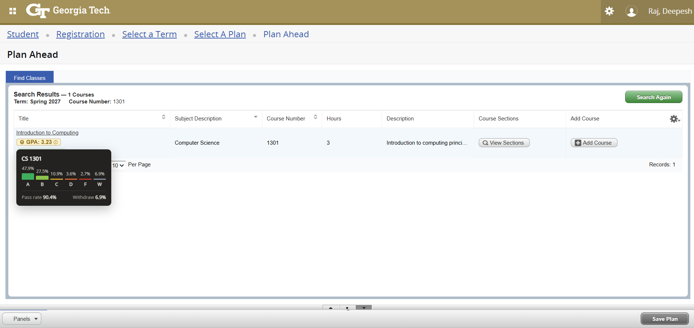
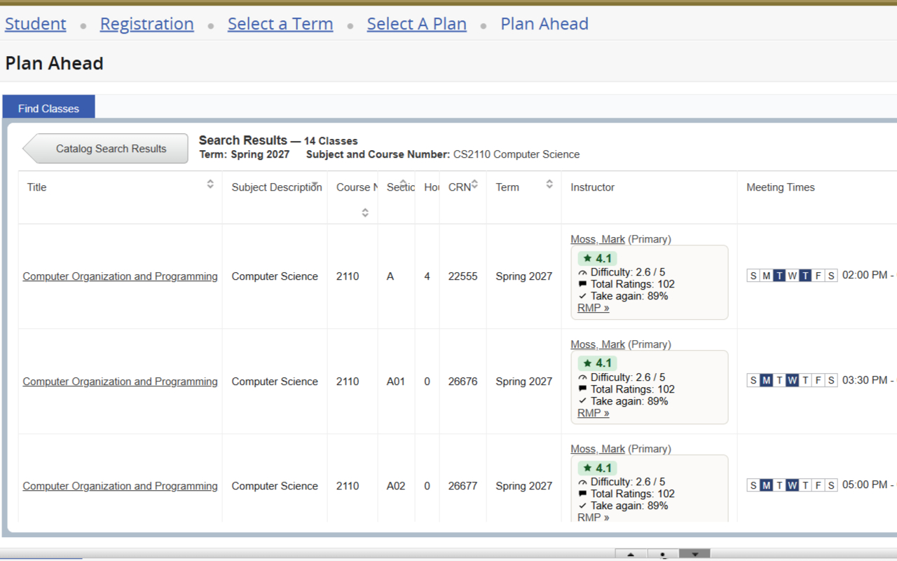

# Stats for bees (iykyk)

**Description:** This Chrome extension integrates Rate My Professors (RMP) ratings and Course Critique data directly into Georgia Tech's registration pages, so professor ratings and class metrics show up right where you're searching for classes.

## Installation
### Chrome Web Store
Download now at https://chromewebstore.google.com/detail/rate-my-professor-for-geo/ijbgdjbenljnebehiaanbmbpdidapldl

## Preview
 
*Course critique data automatically inserted into the Course Title column of GT's registration search results*
 
*RMP metrics automatically inserted into the Instructor column of GT's registration search results*

## Features
* Automatic professor and course detection, with metrics integrated directly into GT's registration search results
* Real-time data fetching from Rate My Professors via the Rate My Professors GraphQL API
* Real-time grade data fetching from Georgia Tech Course Critique
* Color-coded overall rating/GPA so professor and course quality are visible at a glance
* Direct display of comprehensive RMP metrics including:
    * Overall Rating (out of 5)
    * Difficulty Score (out of 5)
    * Total Number of Ratings
    * Percentage who'd take the professor again
* Course Critique data shown at two levels:
    * **Course-wide**, on the initial search results page (before viewing sections): average GPA, with a hover tooltip showing the full A/B/C/D/F/W grade distribution, pass rate, and withdraw rate
    * **Per-instructor**, once you're viewing a course's sections: that specific professor's own average GPA in that course, shown alongside their RMP rating (the course-wide number isn't repeated here, since it'd just be redundant next to the per-instructor one)
* Clickable links to full Rate My Professors profiles and Course Critique course pages
* Co-taught sections show every listed instructor, each with their own RMP and Course Critique data in one shared box
* Clear fallback states for professors/courses without data

### Manual Installation (For Development)
1. Clone this repository: `git clone https://github.com/RDxBros/rmp-cc-gatech-extension.git`
2. Open Chrome and navigate to `chrome://extensions/`
3. Enable "Developer mode" using the toggle in the top-right corner
4. Click "Load unpacked"
5. Select the directory containing the extension files

## Usage
1. Navigate to GT Registration (OSCAR) and make a search within the **Register for Classes**, **Browse Classes**, or **Plan Ahead** sections.
2. The extension automatically detects course and professor names found in the search results.
3. On the initial course search results page (before viewing sections), a GPA chip appears next to each course's title:
    * Hover it to see the full grade distribution (A/B/C/D/F/W), pass rate, and withdraw rate
    * Click "Course Critique »" to view the course's full Course Critique page
4. Once you're viewing a course's individual sections, each professor's table cell shows both their RMP rating and their own GPA in that specific course, in the following format:
    * Overall Rating (out of 5)
    * Difficulty Score (out of 5)
    * Total Number of Ratings
    * Take again %
    * RMP »
    * GPA (hover for that professor's grade distribution in this course)
    * Course Critique »
5. Click "RMP »" to visit the professor's full Rate My Professors profile based on their most relevant department.
6. If a professor doesn't have a Rate My Professors page, "No page found." is displayed instead. If they have a page but no ratings yet, "No ratings yet." is displayed. Course Critique data falls back to "No Course Critique data." the same way when none is found.

## Configuration
This extension currently operates without requiring any configuration. It automatically:
* Detects professor names in the registration results table
* Fetches and displays relevant metrics
* Updates information as search results change

## Browser Support
* Chrome/Chromium-based browsers
* Other browsers not currently supported

## Limitations
* **Georgia Tech Registration Only:** This extension is specifically designed for Georgia Tech's registration system (registration.banner.gatech.edu). It will not work or function properly on other university websites or course registration platforms.

* **Performance:** Retrieving Rate My Professors data for a large number of search results (e.g., more than 10 courses) can sometimes take a few seconds. If you experience slowdowns, try refining your search to reduce the number of displayed courses.

* **Rate My Professors Data Dependence:** The accuracy and availability of professor ratings depend entirely on Rate My Professors data. Some professors may not have RMP profiles, and existing ratings may not always be representative of all student experiences.

* **Professor Department Matching:** The displayed department for a professor is based on their most-reviewed department on Rate My Professors. This may not always match the department of the course they are currently teaching, especially if the professor teaches in multiple departments.

* **Lab/Recitation-Only Instructors:** A section's lab/recitation instructor (when listed separately from the lecture's primary instructor) is not yet looked up.

* **Course Critique Data Dependence:** GPA and grade-distribution data depend entirely on what Course Critique has recorded. A course or instructor with no recorded sections will show "No Course Critique data."

## License
This project is licensed under the MIT License — see the [LICENSE](LICENSE) file for details.

Due to the nature of the Rate My Professors and Course Critique APIs and the limited ways to access their data, the technical implementation of certain functionalities, such as querying Rate My Professors via GraphQL or aggregating Course Critique's per-section grade data, might share similarities with other projects that also utilize these APIs.
