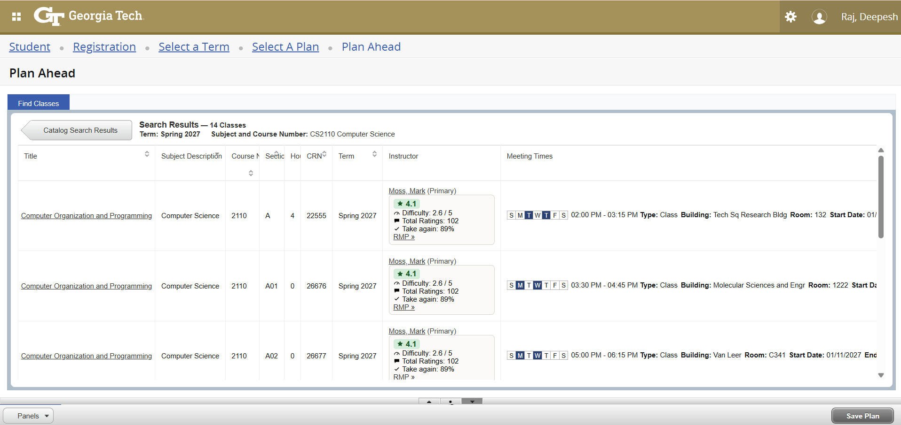

# Stats for bees (iykyk)

**Description:** This Chrome extension integrates Rate My Professors (RMP) data directly into Georgia Tech's registration pages, so professor insights and metrics show up right where you're searching for classes.

## Installation
### Chrome Web Store
Download now at https://chromewebstore.google.com/detail/rate-my-professor-for-geo/ijbgdjbenljnebehiaanbmbpdidapldl

## Preview
 
*RMP metrics automatically inserted into the Instructor column of GT's registration search results*

## Features
* Automatic professor detection and metric integration in GT's registration search results
* Real-time data fetching from Rate My Professors via the Rate My Professors GraphQL API
* Color-coded overall rating so professor quality is visible at a glance
* Direct display of comprehensive metrics including:
    * Overall Rating (out of 5)
    * Difficulty Score (out of 5)
    * Total Number of Ratings
    * Percentage who'd take the professor again
* Clickable links to full Rate My Professors profiles
* Clear fallback states for professors without an RMP page, or with a page but no ratings yet

### Manual Installation (For Development)
1. Clone this repository: `git clone https://github.com/RDxBros/rmp-cc-gatech-extension.git`
2. Open Chrome and navigate to `chrome://extensions/`
3. Enable "Developer mode" using the toggle in the top-right corner
4. Click "Load unpacked"
5. Select the directory containing the extension files

## Usage
1. Navigate to GT Registration (OSCAR) and make a search within the **Register for Classes**, **Browse Classes**, or **Plan Ahead** sections.
2. The extension automatically detects professor names found in the search results.
3. Within a few seconds, metrics will appear in each professor's table cell in the following format:
    * Overall Rating (out of 5)
    * Difficulty Score (out of 5)
    * Total Number of Ratings
    * Take again %
    * RMP »
4. Click "RMP »" to visit the professor's full Rate My Professors profile based on their most relevant department.
5. If a professor doesn't have a Rate My Professors page, "No page found." is displayed instead. If they have a page but no ratings yet, "No ratings yet." is displayed.

## Configuration
This extension currently operates without requiring any configuration. It automatically:
* Detects professor names in the registration results table
* Fetches and displays relevant metrics
* Updates information as search results change

## Browser Support
* Chrome/Chromium-based browsers
* Other browsers not currently supported

## Limitations
* **Georgia Tech Registration Only:** This extension is specifically designed for Georgia Tech's registration system (registration.banner.gatech.edu). It will not work or function properly on other university websites or course registration platforms.

* **Performance:** Retrieving Rate My Professors data for a large number of search results (e.g., more than 10 courses) can sometimes take a few seconds. If you experience slowdowns, try refining your search to reduce the number of displayed courses.

* **Rate My Professors Data Dependence:** The accuracy and availability of professor ratings depend entirely on Rate My Professors data. Some professors may not have RMP profiles, and existing ratings may not always be representative of all student experiences.

* **Professor Department Matching:** The displayed department for a professor is based on their most-reviewed department on Rate My Professors. This may not always match the department of the course they are currently teaching, especially if the professor teaches in multiple departments.

* **Primary Instructor Only:** Only the primary instructor on a section currently gets a rating lookup; co-instructors and lab/recitation-only instructors are not yet looked up separately.

## License
This project is licensed under the MIT License — see the [LICENSE](LICENSE) file for details.

Due to the nature of the Rate My Professors API and the limited ways to access its data, the technical implementation of certain functionalities, such as querying the API using GraphQL, might share similarities with other projects that also utilize this API.
